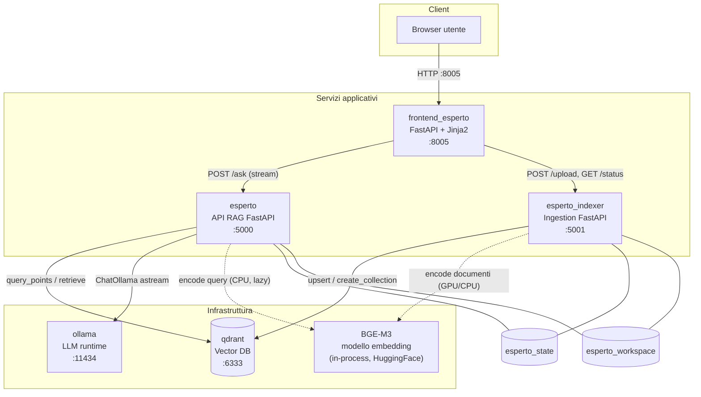
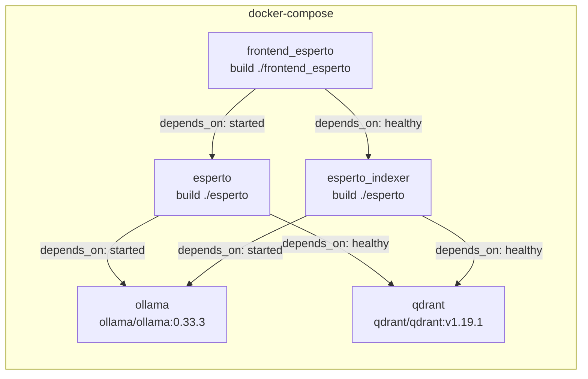
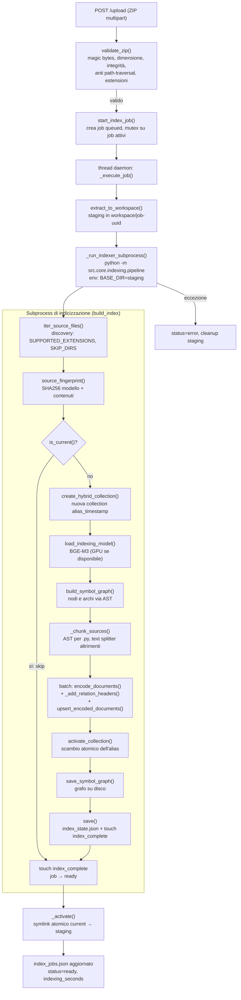
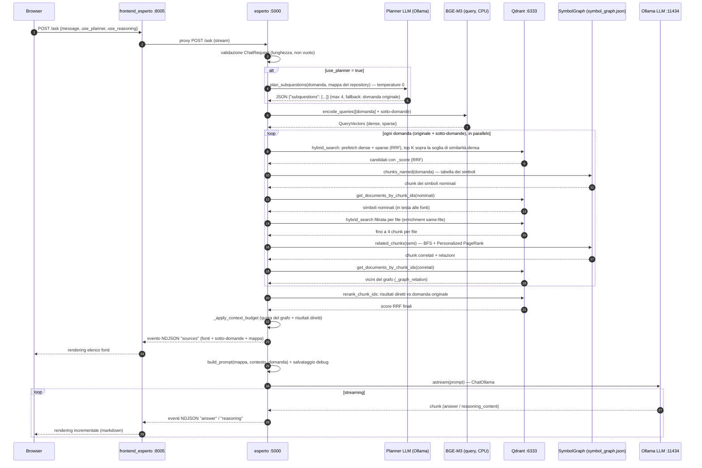

# ARCHITECTURE.md — Sistema "Esperto di Codebase"

> Documento di architettura del sistema RAG (Retrieval-Augmented Generation) per l'interrogazione di codebase Python.
> Ultimo aggiornamento: 2026-10-08.

## Indice

1. [Panoramica](#1-panoramica)
2. [Architettura di alto livello](#2-architettura-di-alto-livello)
3. [Vista di deployment](#3-vista-di-deployment)
4. [Struttura del codice](#4-struttura-del-codice)
5. [Pipeline di indicizzazione](#5-pipeline-di-indicizzazione)
6. [Pipeline di interrogazione RAG](#6-pipeline-di-interrogazione-rag)
7. [Modello dati Qdrant](#7-modello-dati-qdrant)
8. [Symbol graph](#8-symbol-graph)
9. [API Reference](#9-api-reference)
10. [Frontend](#10-frontend)
11. [Configurazione](#11-configurazione)
12. [Persistenza e volumi](#12-persistenza-e-volumi)
13. [Sicurezza](#13-sicurezza)
14. [Testing](#14-testing)
15. [Decisioni architetturali](#15-decisioni-architetturali)
16. [Limitazioni note](#16-limitazioni-note)

---

## 1. Panoramica

**Esperto** è un assistente tecnico per codebase basato su **Retrieval-Augmented Generation**. L'utente carica l'archivio ZIP di un progetto software attraverso un'interfaccia web; il sistema lo indicizza in un database vettoriale e risponde a domande in linguaggio naturale con risposte generate da un LLM locale, **ancorate esclusivamente al codice indicizzato** e corredate dalle fonti (file, simbolo, righe).

### 1.1 Caratteristiche chiave

- **Retrieval ibrido**: ricerca densa (BGE-M3, 1024 dimensioni) e ricerca lessicale sparsa (BM25-like) fuse con Reciprocal Rank Fusion (RRF).
- **Chunking semantico AST-aware**: i file Python sono suddivisi per funzione/classe tramite parsing AST, preservando gli import di contesto; fallback a chunking testuale per gli altri formati.
- **Symbol graph statico**: grafo di chiamate/ereditarietà/import costruito via AST (senza eseguire il codice) e usato a runtime per espandere il contesto con simboli correlati, tramite BFS bidirezionale e Personalized PageRank.
- **Planner LLM**: decomposizione opzionale della domanda in sotto-domande per interrogazioni multi-parte.
- **Ingestion asincrona**: upload ZIP validato lato sicurezza, estrazione in staging, indicizzazione in job di background isolato in subprocess, nuovo indice costruito in una collection separata e attivato con uno scambio atomico di alias Qdrant.
- **Streaming NDJSON**: risposta in streaming con eventi tipizzati (`sources`, `reasoning`, `answer`).
- **Idempotenza dell'indice**: fingerprint SHA256 dei sorgenti per evitare re-indicizzazioni inutili.

### 1.2 Stack tecnologico

| Componente | Tecnologia | Versione |
|---|---|---|
| Linguaggio | Python | 3.10 |
| API framework | FastAPI + Uvicorn | 0.141.1 / 0.52.1 |
| Validazione | Pydantic | 2.13.x |
| Orchestrazione LLM | LangChain (core, ollama, text-splitters) | 1.5.3 / 1.1.0 / 1.1.2 |
| Vector database | Qdrant | v1.19.1 (server) / 1.19.0 (client) |
| LLM runtime | Ollama | 0.33.3 |
| Embedding model | BGE-M3 (BAAI/bge-m3) via FlagEmbedding | 1.4.0 |
| Deep learning | PyTorch (CUDA 12.4) | 2.6.0+cu124 |
| Frontend | Jinja2 + HTML/JS (no framework) | 3.1.6 |
| Container | Docker + docker-compose | — |

---

## 2. Architettura di alto livello

Il sistema è composto da **cinque servizi** orchestrati con docker-compose, più un servizio opzionale di **benchmark** (profilo compose `benchmark`, vedi [§14](#14-testing)). I tre servizi applicativi (`esperto`, `esperto_indexer`, `frontend_esperto`) condividono la stessa base di codice Python (i primi due) e comunicano via HTTP interno.



### 2.1 Ruoli e responsabilità

| Servizio | Immagine / Build | Porta | Ruolo |
|---|---|---|---|
| `frontend_esperto` | build `./frontend_esperto` | 8005 (esposta) | UI web: chat con streaming, upload ZIP, badge di stato sistema |
| `esperto` | build `./esperto` | 5000 (esposta) | API di interrogazione: `/ask` (streaming NDJSON), `/retrieve` e `/health` |
| `esperto_indexer` | build `./esperto` (stessa immagine, comando diverso) | 5001 (solo interna) | Ingestion: `/upload`, `/status`, `/health`; esegue l'indicizzazione |
| `qdrant` | `qdrant/qdrant:v1.19.1` | 6333 | Vector database: collezione ibrida dense + sparse |
| `ollama` | `ollama/ollama:0.33.3` | 11434 | Runtime LLM locale per la generazione in streaming |
| `benchmark` (profilo `benchmark`) | build `./benchmark` | 5002 (esposta) | Valutazione: indicizza un repository di riferimento, interroga `esperto` su un gold set e produce il report |

### 2.2 Separazione dei processi

`esperto` e `esperto_indexer` condividono codice e immagine Docker ma sono **processi separati per design**:

- L'**indexer** esegue il lavoro pesante e sincrono (parsing AST, embedding in batch, upsert) senza bloccare il servizio di query.
- Il **servizio di query** carica il modello di embedding solo per le query (lazy, su CPU di default) e mantiene latenze contenute.
- Lo stato condiviso transita solo attraverso **volumi su disco** (`esperto_state`, `esperto_workspace`) e **Qdrant**: non esiste comunicazione diretta tra i due processi.

---

## 3. Vista di deployment

### 3.1 Definizione servizi (docker-compose)



| Servizio | Volumi | Variabili d'ambiente chiave | Healthcheck | GPU |
|---|---|---|---|---|
| `ollama` | `./ollama_data:/root/.ollama` | `OLLAMA_CONTEXT_LENGTH=${LLM_CONTEXT_TOKENS:-20000}`, `OLLAMA_KV_CACHE_TYPE=q4_0`, `OLLAMA_FLASH_ATTENTION=1`, `OLLAMA_KEEP_ALIVE=-1` | — | NVIDIA ×1 (opzionale) |
| `qdrant` | `./qdrant_data:/qdrant/storage` | — | TCP :6333, interval 10s, retries 12 | — |
| `esperto` | `./hf_cache:/root/.cache/huggingface`, `./esperto_state:/app/state`, `esperto_workspace:/app/workspace`, `./esperto_debug:/app/debug` | `.env` + `HF_HOME`, `PROMPT_DEBUG_FILE=/app/debug/last_prompt.json` | `curl -f http://127.0.0.1:5000/health`, start_period 30s, retries 20 | NVIDIA ×1 (opzionale) |
| `esperto_indexer` | `./hf_cache:/root/.cache/huggingface`, `./esperto_state:/app/state`, `esperto_workspace:/app/workspace` | `.env` + `HF_HOME`, `INGESTION_WORKSPACE_DIR=/app/workspace` | `curl -f http://127.0.0.1:5001/health`, start_period 15s | NVIDIA ×1 (opzionale) |
| `frontend_esperto` | — | `ESPERTO_URL=http://esperto:5000`, `ESPERTO_INDEXER_URL=http://esperto_indexer:5001`, `PYTHONPATH=/app` | — | — |
| `benchmark` | `./benchmark/datasets:/app/datasets`, `./benchmark_results:/app/results` | `.env` + `ESPERTO_URL`, `ESPERTO_INDEXER_URL`, `OLLAMA_URL` | — | — |

Volume condiviso dichiarato in compose: `esperto_workspace` (named volume, montato da entrambi i servizi `esperto*`).

### 3.2 Dipendenze di avvio

1. `ollama` e `qdrant` partono per primi (infrastruttura).
2. `esperto` attende `ollama` avviato e `qdrant` healthy; `esperto_indexer` idem.
3. `frontend_esperto` attende `esperto` avviato e `esperto_indexer` healthy.
4. `benchmark` (solo con `--profile benchmark`) attende `esperto` ed `esperto_indexer` healthy.

### 3.3 Configurazione Ollama

Il container Ollama è configurato per un uso RAG intensivo:

- `OLLAMA_CONTEXT_LENGTH`: vale `LLM_CONTEXT_TOKENS` (default 20000), lo stesso parametro che `esperto` passa a Ollama come `num_ctx` e da cui deriva il budget del contesto recuperato (due terzi della finestra, stimando ~3 caratteri per token: 40000 caratteri).
- `OLLAMA_KV_CACHE_TYPE=q4_0`: KV cache quantizzata per ridurre l'occupazione di memoria GPU.
- `OLLAMA_FLASH_ATTENTION=1`: flash attention per efficienza.
- `OLLAMA_KEEP_ALIVE=-1`: il modello non viene mai scaricato dalla memoria tra una richiesta e l'altra.

---

## 4. Struttura del codice

### 4.1 Backend `esperto/`

```
esperto/
├── config.py                    # AppConfig (Pydantic): validazione centralizzata delle env
├── dockerfile                   # python:3.10-slim, dipendenze, EXPOSE 5000
├── pyproject.toml               # configurazione mypy
├── requirements.txt
└── src/
    ├── api.py                   # FastAPI :5000 — POST /ask (streaming), POST /retrieve, GET /health
    ├── core/
    │   ├── indexing/            # pipeline di indicizzazione
    │   │   ├── pipeline.py      #   orchestrazione: build_index(), _chunk_sources()
    │   │   ├── discovery.py     #   discovery file: iter_source_files(), relative_path(), service_for_path()
    │   │   ├── chunking.py      #   PythonASTContextualChunker + fallback_text_split()
    │   │   ├── symbol_graph.py  #   grafo statico: build_symbol_graph(), chunk_relations(), save_symbol_graph()
    │   │   └── repo_map.py      #   mappa del repository per planner e prompt: build_repo_map(), save_repo_map()
    │   ├── rag/                 # pipeline di interrogazione
    │   │   ├── chain.py         #   stream_expert_response(): composizione retriever + LLM
    │   │   ├── retrieval.py     #   HybridRetriever.retrieve(): candidati, rerank finale, budget
    │   │   ├── planner.py       #   plan_subquestions(), parse_subquestions()
    │   │   └── prompts.py       #   build_prompt(), INSTRUCTION (regole di grounding)
    │   ├── services/            # integrazione servizi esterni
    │   │   ├── qdrant.py        #   client sync/async, create_hybrid_collection(), activate_collection(), hybrid_search(), upsert_encoded_documents()
    │   │   ├── embedding.py     #   ciclo di vita BGE-M3: load_indexing_model(), get_query_model(), encode_*()
    │   │   ├── index_state.py   #   fingerprint e stato: source_fingerprint(), is_current(), save()
    │   │   └── symbol_graph.py  #   SymbolGraph runtime: related_chunks() via BFS + PageRank, chunks_named()
    │   └── shared/
    │       ├── options.py       #   RetrievalOptions: interruttori per richiesta (ablation)
    │       ├── vectors.py       #   QueryVectors, lexical_weights_to_sparse_vector()
    │       └── text.py          #   sanitize_text(), without_imports()
    ├── ingestion/               # servizio di ingestion (:5001)
    │   ├── api.py               #   POST /upload, GET /status, GET /health
    │   ├── workspace.py         #   job in background, staging, attivazione atomica, subprocess
    │   └── zip_validation.py    #   validate_zip(): magic bytes, path traversal, integrità
    └── tests/                   # pytest: chain, chunking, planner, repo_map, retrieval, symbol_graph, zip_validation
```

### 4.2 Frontend `frontend_esperto/`

```
frontend_esperto/
├── config.py                    # ESPERTO_URL, ESPERTO_INDEXER_URL, directory template/static
├── dockerfile
├── requirements.txt             # fastapi, uvicorn, jinja2, requests, python-multipart
└── src/
    ├── main.py                  # route: GET /, GET /api/status, POST /api/index/upload, POST /ask
    ├── classi.py                # ChatFrontendRequest (Pydantic)
    ├── logcon.py                # logger centralizzato (logs/frontend_esperto.log)
    ├── templates/
    │   ├── base.html            #   layout: header sticky, badge stato sistema, dialog
    │   └── esperto.html         #   pagina chat: form domanda, toggle opzioni, upload, risultati
    └── static/
        ├── ui.js                #   notify(), setBusy(), confirmAction(), shortcut Ctrl+Enter
        └── style.css            #   dark theme con variabili CSS, griglia responsive
```

### 4.3 Benchmark `benchmark/`

```
benchmark/
├── config.py                    # URL dei servizi, modello della baseline closed-book, directory dataset/risultati
├── dockerfile                   # python:3.10-slim + git (clone del repository di riferimento)
├── requirements.txt             # fastapi, httpx, pyyaml, pydantic
├── datasets/
│   ├── requests/                #   psf/requests v2.32.3: 62 file, 88 domande
│   │   ├── dataset.yaml         #     repository e ref fissato
│   │   └── questions.yaml       #     gold set in 6 categorie, con simboli rilevanti e fatti chiave
│   ├── requests_en/             #   stesse domande di requests tradotte in inglese
│   └── piccolo/                 #   piccolo-orm/piccolo 1.22.0: 407 file, 60 domande (repository medio e meno noto)
├── src/
│   ├── api.py                   # FastAPI :5002 — avvio, ripresa, stato, verdetti e report dei run
│   ├── runner.py                # RunSpec, CONFIGS (ablation), campionamento, stadi retrieval e generazione
│   ├── dataset.py               # caricamento e validazione del gold set, clone e ZIP del repository
│   ├── esperto_client.py        # client HTTP verso esperto e indexer, con tempi dello stream
│   ├── metrics.py               # metriche di retrieval, citazioni, bootstrap, kappa
│   ├── ollama.py                # client minimale per l'API chat di Ollama (baseline closed-book)
│   └── report.py                # summary.json/csv e report.md
└── tests/                       # pytest: api, dataset, metrics, runner
```

### 4.4 Moduli chiave e simboli principali

| Modulo | Simboli chiave | Responsabilità |
|---|---|---|
| [esperto/src/api.py](esperto/src/api.py) | `ChatRequest`, `ask_expert()`, `retrieve()`, `health_check()` | Contratto HTTP del servizio di query |
| [esperto/src/core/indexing/pipeline.py](esperto/src/core/indexing/pipeline.py) | `build_index()` | Orchestrazione end-to-end dell'indicizzazione |
| [esperto/src/core/indexing/chunking.py](esperto/src/core/indexing/chunking.py) | `PythonASTContextualChunker`, `fallback_text_split()` | Chunking semantico Python + fallback testuale |
| [esperto/src/core/indexing/discovery.py](esperto/src/core/indexing/discovery.py) | `iter_source_files()`, `relative_path()` | Scoperta dei file sorgente con filtri |
| [esperto/src/core/indexing/symbol_graph.py](esperto/src/core/indexing/symbol_graph.py) | `build_symbol_graph()`, `chunk_relations()`, `save_symbol_graph()` | Grafo statico di simboli/relazioni via AST; relazioni per chunk da scrivere nell'intestazione |
| [esperto/src/core/indexing/repo_map.py](esperto/src/core/indexing/repo_map.py) | `build_repo_map()`, `save_repo_map()` | Mappa del repository (README, cartelle, gerarchia delle classi) per planner e prompt |
| [esperto/src/core/rag/chain.py](esperto/src/core/rag/chain.py) | `stream_expert_response()` | Composizione retrieval → prompt → streaming LLM |
| [esperto/src/core/rag/retrieval.py](esperto/src/core/rag/retrieval.py) | `HybridRetriever.retrieve()` | Candidati per domanda, rerank finale, quota del grafo, budget contesto |
| [esperto/src/core/rag/planner.py](esperto/src/core/rag/planner.py) | `plan_subquestions()`, `parse_subquestions()` | Decomposizione LLM della domanda |
| [esperto/src/core/rag/prompts.py](esperto/src/core/rag/prompts.py) | `build_prompt()`, `INSTRUCTION` | Template di prompt con regole anti-allucinazione |
| [esperto/src/core/services/qdrant.py](esperto/src/core/services/qdrant.py) | `create_hybrid_collection()`, `activate_collection()`, `hybrid_search()`, `rerank_chunk_ids()` | Integrazione Qdrant, alias dell'indice attivo |
| [esperto/src/core/services/embedding.py](esperto/src/core/services/embedding.py) | `load_indexing_model()`, `get_query_model()` | Ciclo di vita BGE-M3 |
| [esperto/src/core/services/index_state.py](esperto/src/core/services/index_state.py) | `source_fingerprint()`, `is_current()` | Idempotenza dell'indice |
| [esperto/src/core/services/symbol_graph.py](esperto/src/core/services/symbol_graph.py) | `SymbolGraph.related_chunks()`, `SymbolGraph.chunks_named()` | Espansione grafo a runtime (BFS + PageRank); tabella dei simboli per nome |
| [esperto/src/ingestion/workspace.py](esperto/src/ingestion/workspace.py) | `start_index_job()`, `extract_to_workspace()` | Job di indicizzazione in background |
| [esperto/src/ingestion/zip_validation.py](esperto/src/ingestion/zip_validation.py) | `validate_zip()` | Validazione sicurezza archivi ZIP |
| [esperto/config.py](esperto/config.py) | `AppConfig` | Configurazione centralizzata e validata |

---

## 5. Pipeline di indicizzazione

L'indicizzazione è attivata esclusivamente dall'**upload di uno ZIP** tramite l'ingestion service. Non esiste indicizzazione di una codebase "live": la sorgente di verità è sempre l'archivio caricato.

### 5.1 Flusso end-to-end



### 5.2 Validazione e staging dell'archivio

La funzione `validate_zip()` in [zip_validation.py](esperto/src/ingestion/zip_validation.py) applica quattro livelli di controllo prima di accettare l'upload:

1. **Formato**: estensione `.zip` e magic bytes `PK\x03\x04`.
2. **Dimensione**: rifiuto oltre `MAX_UPLOAD_MB` (default 200 MB).
3. **Integrità**: `ZipFile.testzip()` per rilevare archivi corrotti.
4. **Contenuto**: rifiuto di path traversal (`../`, percorsi assoluti), filtro per `SUPPORTED_EXTENSIONS`, rifiuto se non resta alcun file indicizzabile.

L'estrazione avviene in una directory di staging isolata `job-{uuid}` dentro il volume `esperto_workspace`. Solo a estrazione riuscita il symlink `current` viene aggiornato atomicamente (`os.replace`), così un eventuale fallimento non lascia mai la workspace in uno stato intermedio.

### 5.3 Isolamento in subprocess

L'indicizzazione vera e propria non gira nel processo dell'ingestion service ma in un **subprocess** (`python -m src.core.indexing.pipeline`) con override di `BASE_DIR`, che punta allo staging. Questo garantisce:

- **Isolamento della memoria**: il modello BGE-M3 in modalità indexing (potenzialmente su GPU, FP16) viene caricato e rilasciato nel subprocess, senza occupare RAM/VRAM del servizio long-running.
- **Isolamento dei fallimenti**: un crash durante l'indicizzazione non abbatte l'ingestion service; lo stato del job riflette l'errore (`status=error` con coda dei log).
- **Configurazione puntuale**: l'indicizzazione avviene sempre contro lo staging appena attivato, indipendentemente dalla configurazione del servizio.

### 5.4 Discovery e fingerprint

`iter_source_files()` in [discovery.py](esperto/src/core/indexing/discovery.py) scansiona `BASE_DIR`, applica il filtro sulle estensioni (`SUPPORTED_EXTENSIONS`) ed esclude le directory in `SKIP_DIRS` (`__pycache__`, `.git`, `node_modules`, …).

`source_fingerprint()` in [index_state.py](esperto/src/core/services/index_state.py) calcola un hash SHA256 che incorpora **sia la configurazione del modello** (nome, dimensione densa, lunghezza massima embedding) **sia il contenuto di ogni file**. Se il fingerprint coincide con quello persistito e la collection esiste già con il symbol graph, l'indicizzazione viene saltata (`is_current()` → `True`): caricare due volte lo stesso archivio è un'operazione a costo quasi nullo.

### 5.5 Chunking semantico

Definito in [chunking.py](esperto/src/core/indexing/chunking.py):

- **File Python** — `PythonASTContextualChunker`: parsing con `ast.parse()`, estrazione delle definizioni top-level (funzioni e classi, decoratori inclusi) come chunk singoli; le classi oltre `CLASS_SPLIT_MIN_LINES=400` righe sono divise in un chunk di intestazione (firma, docstring, attributi e le firme di tutti i metodi, senza corpo) più un chunk `method` per metodo, con `symbol_name` nella forma `Classe.metodo`. Ogni chunk è arricchito con gli **import di contesto** del modulo e metadati ricchi (`filename`, `service`, `chunk_type`, `symbol_name`, `start_line`, `end_line`, `chunk_id`). Il corpo globale del modulo (codice fuori da definizioni) è preservato come chunk `global_body`. In caso di `SyntaxError` si ricade automaticamente sul fallback testuale.
- **Altri formati** — `fallback_text_split()`: `RecursiveCharacterTextSplitter` con `INDEX_CHUNK_SIZE=1200` caratteri e `INDEX_CHUNK_OVERLAP=150`, chunk marcati `text_block` con suffisso `part_N`.

**Intestazione strutturale.** Dopo l'encoding e prima dell'upsert `_add_relation_headers()` in [pipeline.py](esperto/src/core/indexing/pipeline.py) antepone a ogni chunk di simbolo le righe `# EREDITA DA: ...` e `# CHIAMA: ...`, ricavate dal symbol graph con `chunk_relations()` (al più `MAX_HEADER_CALLS=8` chiamate, escluse quelle interne allo stesso chunk; i metodi di una classe spezzata riportano le basi della classe). L'intestazione fa parte del testo salvato e letto dal modello, non di quello da cui si calcolano i vettori. `CHUNKING_VERSION` entra nel fingerprint dell'indice: incrementarla invalida gli indici esistenti.

Il `chunk_id` è deterministico ([§7.3](#73-identificatori-deterministici)).

### 5.6 Costruzione del symbol graph

`build_symbol_graph()` in [indexing/symbol_graph.py](esperto/src/core/indexing/symbol_graph.py) esegue un'analisi **statica** dei file Python con due visitor AST:

- `_DefinitionVisitor`: raccoglie gli identificatori fully-qualified di moduli, classi, funzioni e metodi (nodi del grafo), ciascuno collegato al proprio `chunk_id`. Raccoglie anche i nomi che ogni modulo importa a livello di modulo: servono a seguire le riesportazioni (tipicamente in `__init__.py`) fino alla definizione, per al più `MAX_REEXPORTS=5` passaggi.
- `_GraphVisitor`: estrae gli archi tipizzati — `calls` (chiamate tra simboli), `inherits` (ereditarietà, anche da basi generiche come `Engine[T]`), `imports` — con la riga di origine.

Il grafo è costruito prima del chunking, perché le sue relazioni finiscono nell'intestazione dei chunk ([§5.5](#55-chunking-semantico)), ed è salvato atomicamente dopo l'attivazione del nuovo indice in `esperto_state/symbol_graph.json` con un campo `version` (`SYMBOL_GRAPH_VERSION`): un grafo di versione diversa viene ignorato.

### 5.7 Encoding e upsert

I documenti sono processati in batch (`BATCH_SIZE`, tipicamente 8): `encode_documents()` invoca BGE-M3 ottenendo per ogni chunk due rappresentazioni (`dense_vecs`, `lexical_weights`), quindi `upsert_encoded_documents()` costruisce i `PointStruct` con ID deterministico `uuid5(NAMESPACE_URL, "esperto:{chunk_id}")` e li carica sulla collection. Gli upsert falliti per dimensione eccessiva ricadono su inserimenti individuali.

Al termine: `save()` scrive `index_state.json` (collection, fingerprint, numero file, versione grafo) e tocca il flag `index_complete`, che sblocca l'health check del servizio di query.

---

## 6. Pipeline di interrogazione RAG

L'interrogazione è esposta come `POST /ask` sul servizio `esperto` (:5000) e produce uno **stream NDJSON**: ogni riga è un oggetto JSON indipendente con campo `type` (`sources`, `reasoning`, `answer`) e campo `data`.

### 6.1 Diagramma di sequenza



### 6.2 Planner delle sotto-domande

Con `use_planner=true` (default nel frontend), `plan_subquestions()` in [planner.py](esperto/src/core/rag/planner.py) interroga l'LLM con temperatura 0: se la domanda è già specifica resta da sola, altrimenti viene scomposta in 2-4 sotto-domande autonome. Il planner riceve la mappa del repository ([§6.5](#65-prompt-e-grounding)) e può ancorare le sotto-domande a cartelle e classi reali; il prompt vieta nomi di file, simboli o tecnologie assenti dalla domanda e dalla mappa (senza mappa, assenti dalla domanda). `parse_subquestions()` valida il JSON prodotto, deduplica case-insensitive, filtra frammenti troppo corti e, in caso di output non valido, **ricade sulla domanda originale**: il planner non può mai peggiorare il comportamento di base.

Al retrieval partecipano la domanda originale più al massimo 4 sotto-domande uniche, codificate in un solo passaggio BGE-M3 e cercate in parallelo.

### 6.3 Retrieval ibrido

Implementato da `HybridRetriever` in [retrieval.py](esperto/src/core/rag/retrieval.py) e `hybrid_search()` in [services/qdrant.py](esperto/src/core/services/qdrant.py):

1. **Prefetch parallelo**: ricerca densa (HNSW su vettore `dense`) e ricerca sparsa (vettore `sparse`, pesi lessicali BGE-M3), ciascuna con `PREFETCH_LIMIT` candidati (valore tipico 20).
2. **Fusione RRF**: Reciprocal Rank Fusion combina i ranking denso e sparso senza richiedere normalizzazione degli score.
3. **Soglia di rilevanza**: dei primi `K` chunk fusi si scartano quelli la cui similarità densa (coseno) è sotto `SEMANTIC_RELEVANCE_RATIO` volte la migliore. Lo score RRF dipende solo dalla posizione in classifica, quindi non si presta a una soglia; è esposto come `_score` e ordina i risultati.

### 6.4 Post-processing del contesto

Per ogni domanda (originale e sotto-domande) si raccolgono i candidati con i simboli nominati, enrichment same-file ed espansione via grafo; i candidati di tutte le domande sono poi uniti per `chunk_id`; i risultati diretti sono ri-ordinati sulla domanda originale (`rerank_chunk_ids()`: la fusione dense+sparse ristretta ai candidati), mentre i vicini del grafo saltano il rerank e occupano una quota riservata del budget:

1. **Deduplica** per `chunk_id` mantenendo lo score massimo (`_keep_highest_scoring()`).
2. **Simboli nominati** (`use_symbol_lookup`): le parole della domanda con la forma di un identificatore (un underscore, un punto o una maiuscola) sono cercate nella tabella dei simboli (`SymbolGraph.chunks_named()`); i chunk che le definiscono entrano tra i candidati diretti, in parallelo alla ricerca ibrida, e nelle fonti stanno in testa. Un nome definito in più di `MAX_NAME_MATCHES=3` chunk è ambiguo e viene ignorato. Vale anche per le sotto-domande del planner.
3. **Enrichment same-file**: per ogni file che compare nei top risultati, fino a 4 chunk aggiuntivi dallo stesso file per fornire contesto locale.
4. **Espansione via symbol graph**: i risultati della ricerca e i simboli nominati (non i chunk aggiunti per same-file) fungono da semi per `SymbolGraph.related_chunks()`, che restituisce per ogni domanda fino a `SYMBOL_GRAPH_MAX_NEIGHBORS=6` chunk correlati (funzioni chiamanti/chiamate, superclassi/sottoclassi) con la relazione esposta in `_graph_relation`; i vicini diretti dei primi `TOP_SEEDS=3` semi hanno la precedenza. Vedi [§8](#8-symbol-graph).
5. **Budget di contesto** (`_apply_context_budget()`): ordinamento per score decrescente e selezione entro `RAG_CONTEXT_MAX_SOURCES=35` fonti e il budget di caratteri derivato da `LLM_CONTEXT_TOKENS`. Ai vicini del grafo sono riservati fino a `SYMBOL_GRAPH_MAX_NEIGHBORS` posti per ogni domanda (originale e sotto-domande) e la quota proporzionale di caratteri, mai oltre metà del budget; nelle fonti compaiono in coda, senza score. Nel conteggio dei caratteri gli import del modulo valgono una volta per file, come nel contesto mostrato al modello.

### 6.5 Prompt e grounding

**Mappa del repository.** Prima del contesto recuperato il prompt include una mappa compatta e deterministica, costruita in indicizzazione da `build_repo_map()` in [repo_map.py](esperto/src/core/indexing/repo_map.py) e salvata in `esperto_state/repo_map.txt`. Ha tre parti, entro `REPO_MAP_MAX_CHARS` (il 15% del budget del contesto):

1. **README**: l'inizio del README più vicino alla radice, saltate le righe iniziali di badge e HTML (al più un quarto del budget).
2. **Cartelle**: una riga per cartella con il numero di file indicizzati, alla profondità massima che entra in metà del budget.
3. **Gerarchia delle classi**: per ogni classe base definita fuori dai test, le sottoclassi dirette (al più `MAX_SUBCLASSES=10`), ricavate dagli archi `inherits` del symbol graph; prima le classi con più sottoclassi, finché c'è spazio.

Serve alle domande generali e di architettura, per cui la ricerca per somiglianza non basta. La stessa mappa viene passata al planner, che vi ancora le sotto-domande a cartelle e classi reali. Si disattiva per richiesta con `use_repo_map=false` (ablation `no_repo_map` del benchmark, che incide quindi su retrieval e generazione) ed è inviata al client nell'evento `sources`.

**Ordine del contesto.** `_build_context()` in [chain.py](esperto/src/core/rag/chain.py) raggruppa le fonti per file: i file nell'ordine del loro chunk meglio classificato, i chunk dello stesso file per riga. Il blocco degli import del modulo, presente in ogni chunk, resta solo sul primo chunk di ogni file (`without_imports()`). L'elenco `sources` inviato al client resta in ordine di rilevanza e con il testo completo.

`build_prompt()` in [prompts.py](esperto/src/core/rag/prompts.py) compone un unico `HumanMessage` (alcuni modelli Ollama gestiscono male un `SystemMessage` separato) con, nell'ordine: mappa del repository, domanda, contesto recuperato, regole e di nuovo la domanda. La mappa, uguale a ogni richiesta, apre il prompt perché Ollama ne riusi la cache; la domanda precede il contesto perché il modello lo legga sapendo cosa cercare. Le regole sono cinque:

- usare solo il codice e le informazioni del contesto, senza inventare file, funzioni o librerie;
- se la risposta non è nel contesto, dichiararlo esplicitamente;
- citare file e funzione o classe di riferimento;
- per le modifiche proposte, mostrare "Prima" e "Dopo";
- essere concisi.

Il prompt renderizzato di ogni richiesta è salvato in `esperto_debug/last_prompt.json` (`PROMPT_DEBUG_FILE`) per ispezione.

### 6.6 Streaming e gestione errori

`stream_expert_response()` in [chain.py](esperto/src/core/rag/chain.py) è un async generator che emette nell'ordine:

| `type` | `data` | Quando |
|---|---|---|
| `sources` | `{sources: [...], subquestions: [...], repo_map: "..."}` | Una volta, prima della generazione |
| `reasoning` | frammento di reasoning | Solo se `use_reasoning=true` e il modello lo produce |
| `answer` | frammento di risposta | Streaming incrementale del completamento |

Le fonti includono `filename`, `service`, `chunk_type`, `symbol_name`, `start_line`, `end_line`, `score` ed eventualmente `graph_relation`. Gli errori a metà stream (durata complessiva oltre `LLM_INFERENCE_TIMEOUT`, timeout o errori di Qdrant, eccezioni generiche) sono convertiti in eventi `[ERROR] ...` invece di troncare silenziosamente la risposta.

---

## 7. Modello dati Qdrant

### 7.1 Spazi vettoriali della collection

`QDRANT_COLLECTION` (default d'uso `codebase_expert_bgem3_v1`) è un **alias**: ogni indicizzazione crea una collection `<alias>_<timestamp>` e `activate_collection()` vi sposta l'alias in un'unica operazione, eliminando poi la precedente. Durante la ricostruzione, o se questa fallisce, le query continuano a vedere l'indice precedente con il suo symbol graph. La collection è **ibrida a due spazi**, creata da `create_hybrid_collection()` in [services/qdrant.py](esperto/src/core/services/qdrant.py):

| Vettore | Dimensione | Distanza | Indicizzazione | Storage | Quantizzazione | Ruolo |
|---|---|---|---|---|---|---|
| `dense` | 1024 | COSINE | HNSW | RAM | INT8 scalare (quantile 0.99, sempre in RAM) | Similarità semantica a livello di chunk |
| `sparse` | variabile | — | indice sparse dedicato | RAM | — | Matching lessicale BM25-like (da `lexical_weights` BGE-M3) |

La fusione RRF combina i due spazi senza normalizzare gli score: la densa cattura il significato, la sparsa i termini esatti (nomi di simboli).

### 7.2 Payload dei punti

Ogni punto rappresenta un chunk e porta:

```json
{
  "page_content": "# FILE: src/api.py | SERVIZIO: src\n# TIPO: FUNCTION | NOME: ask_expert\n...imports e codice...",
  "metadata": {
    "filename": "src/api.py",
    "service": "src",
    "chunk_type": "function",
    "symbol_name": "ask_expert",
    "start_line": 82,
    "end_line": 106,
    "chunk_id": "9f2c…(md5)"
  }
}
```

Valori di `chunk_type`: `function`, `class`, `method`, `global_body`, `text_block`. Il campo `service` è derivato dal percorso (`service_for_path()`) e usato nei metadati esposti al client.

### 7.3 Identificatori deterministici

- **`chunk_id`**: deterministico — `MD5(filename::symbol_name::riga_def-1::end_line)` per simboli Python, `MD5(filename::part_N)` per blocchi testuali.
- **Point ID Qdrant**: `uuid5(NAMESPACE_URL, "esperto:{chunk_id}")` — UUID valido derivato deterministicamente dal chunk_id.

Questa catena rende ogni re-indicizzazione **sovrascrittura idempotente** degli stessi punti: nessun duplicato orfano nella collection, nessuna dipendenza da stato esterno per ricostruire gli ID.

---

## 8. Symbol graph

Il symbol graph è l'elemento che distingue il retrieval di Esperto da una semplice ricerca vettoriale: fornisce al sistema la **struttura del codice** (chi chiama chi, chi eredita da chi) in forma interrogabile.

### 8.1 Formato persistito

`esperto_state/symbol_graph.json`:

```json
{
  "version": 1,
  "nodes": [
    {
      "id": "src.api::ask_expert",
      "kind": "function",
      "name": "ask_expert",
      "filename": "src/api.py",
      "start_line": 82,
      "end_line": 106,
      "chunk_id": "9f2c…"
    }
  ],
  "edges": [
    {
      "source": "src.api::ask_expert",
      "target": "src.rag::stream_expert_response",
      "kind": "calls",
      "line": 95
    }
  ]
}
```

Tipi di nodo: `module`, `class`, `function`, `method`. Tipi di arco: `calls`, `inherits`, `imports`. Il campo `version` è verificato a caricamento: un grafo con versione non corrente viene ignorato (comportamento degrado graceful a retrieval senza espansione).

### 8.2 Uso a runtime

La classe `SymbolGraph` in [services/symbol_graph.py](esperto/src/core/services/symbol_graph.py) è caricata lazy dal retriever e si auto-ricarica se il file cambia su disco (`_reload_if_needed()`), così una nuova indicizzazione è recepita senza riavvio del servizio.

`chunks_named(text)` è la tabella dei simboli: al caricamento ogni nodo è indicizzato per nome corto (`login`) e qualificato (`BaseUser.login`) verso il chunk che lo contiene; la ricerca è esatta e distingue maiuscole e minuscole ([§6.4](#64-post-processing-del-contesto)).

`related_chunks(chunk_ids, limit, top_chunk_ids)` esegue:

1. **BFS bidirezionale** dagli archi `calls`/`inherits` a partire dai simboli seed, con profondità massima `SYMBOL_GRAPH_MAX_DEPTH=3`, escludendo i seed stessi e i chunk già presenti nel contesto.
2. **Personalized PageRank** sui candidati raggiunti (damping `0.4`, 20 iterazioni, tolleranza `1e-6`), personalizzato sui seed (teleport e massa dei nodi senza archi uscenti tornano ai seed) e propagato sui soli archi diretti; a parità di score, come per i chiamanti, prevale il percorso BFS più corto.
3. **Precedenza ai vicini diretti** dei primi risultati (`top_chunk_ids`): i chunk a un passo da quei semi vengono prima di tutti gli altri, e tra loro prima quelli nello stesso scope (classe o modulo) del seme; completano le catene di chiamate che la ricerca per somiglianza non trova.
4. **Selezione** dei top `SYMBOL_GRAPH_MAX_NEIGHBORS=6` chunk correlati, ciascuno annotato con il percorso BFS più breve come stringa di relazione (esposta al client come `graph_relation`).

L'effetto pratico: se l'utente chiede di una funzione, il contesto include automaticamente anche i suoi chiamanti e le funzioni che invoca, anche se lessicalmente dissimili dalla domanda.

---

## 9. API Reference

### 9.1 Servizio di query — `esperto` (:5000)

#### `POST /ask`

Interroga il sistema con risposta in streaming.

**Request body** (`ChatRequest`):

| Campo | Tipo | Default | Vincoli |
|---|---|---|---|
| `message` | string | — | `MIN_MESSAGE_LENGTH` (3) ≤ len ≤ `MAX_MESSAGE_LENGTH` (5000), non vuoto dopo strip |
| `use_planner` | bool | `true` | attiva la decomposizione in sotto-domande |
| `use_reasoning` | bool | `false` | inoltra i frammenti di reasoning del modello, se prodotti |
| `retrieval` | object | tutti `true` | `RetrievalOptions`: `use_dense`, `use_sparse`, `use_same_file`, `use_symbol_graph`, `use_symbol_lookup`, `use_repo_map`, più `k` (1–50, default: `K` di configurazione); almeno uno tra dense e sparse deve restare attivo |

**Response**: `StreamingResponse`, `text/plain; charset=utf-8`, una riga JSON per evento:

```json
{"type": "sources", "data": {"sources": [{"filename": "…", "symbol_name": "…", "chunk_type": "…", "score": 0.83, "graph_relation": null}], "subquestions": ["…"], "repo_map": "…"}}
{"type": "reasoning", "data": "…frammento di ragionamento…"}
{"type": "answer", "data": "…frammento di risposta…"}
```

**Errori**: `400` messaggio non valido; `500` errore interno; eventi `[ERROR]` inline per timeout/errori a stream avviato.

#### `POST /retrieve`

Planner + retrieval senza generazione, usato dal benchmark. Stesso corpo di `/ask` senza `use_reasoning`, più `subquestions` opzionale: un piano già calcolato che salta il planner; risponde con `{"subquestions": [...], "sources": [...]}`. Un errore o timeout di Qdrant produce `500`, mai una lista di fonti vuota.

#### `GET /health`

Stato dell'indice, usato da healthcheck Docker e dal badge del frontend:

| Stato | Significato |
|---|---|
| `not_indexed` | flag `index_complete` assente: caricare uno ZIP |
| `indexing` | flag presente ma collection vuota: indicizzazione in corso |
| `ok` | indice pronto; include `points_count` |

### 9.2 Ingestion service — `esperto_indexer` (:5001, solo rete interna)

#### `POST /upload`

Accetta un archivio ZIP multipart (campo `file`), lo valida e accoda il job di indicizzazione.

- **Successo**: `HTTP 202` con `{status: "queued", job: {job_id, filename, status, files, started_at}}`.
- **Errori**: `400` archivio non valido (estensione, magic bytes, integrità, path traversal, nessun file supportato, oltre `MAX_UPLOAD_MB`); `409` un job è già `queued` o `indexing`.

#### `GET /status`

Stato del job corrente: `{status: "not_indexed"|"queued"|"indexing"|"ready"|"error", job: {...}}` con `files`, `started_at`, `finished_at`, `error`, `indexing_seconds`. Job rimasti `queued`/`indexing` dopo un riavvio sono marcati `error` al caricamento (job stale).

#### `GET /health`

`{"status": "ok"}` — usato dal healthcheck Docker.

### 9.3 Frontend — `frontend_esperto` (:8005)

| Metodo | Path | Funzione |
|---|---|---|
| GET | `/` | Pagina chat (`esperto.html`) con badge di stato sistema |
| GET | `/api/status` | Aggrega `/health` di `esperto` e `/status` dell'indexer |
| POST | `/api/index/upload` | Proxy multipart verso indexer `/upload` (timeout 10s/120s) |
| POST | `/ask` | Proxy streaming verso `esperto` `/ask` (timeout 10s/300s) |

Il frontend agisce da **proxy trasparente**: nessuna logica RAG risiede qui; valida solo la forma della richiesta (`ChatFrontendRequest`) e inoltra lo stream.

### 9.4 Benchmark — `benchmark` (:5002)

| Metodo | Path | Funzione |
|---|---|---|
| POST | `/runs` | Avvia un run in background (`202`, restituisce `run_id`); `409` se un run è già in corso |
| POST | `/runs/{run_id}/resume` | Riprende un run interrotto con la stessa specifica, saltando indicizzazione e domande già completate |
| GET | `/runs` | Elenco dei run presenti in `benchmark_results/` |
| GET | `/runs/{run_id}` | Avanzamento (`status.json`: stadio, completate, totale, errore) |
| GET | `/runs/{run_id}/report` | Report Markdown del run concluso |
| POST | `/runs/{run_id}/judgments` | Riceve i verdetti sulle risposte di `to_judge.jsonl` e rigenera il report |
| POST | `/datasets/{nome}/validate` | Verifica che file e simboli del gold set esistano nel repository |

Corpo di `POST /runs` (`RunSpec`):

| Campo | Default | Descrizione |
|---|---|---|
| `dataset` | — | Nome della cartella in `benchmark/datasets/` |
| `stages` | `["retrieval", "generation"]` | Stadi da eseguire |
| `retrieval_configs` | tutte | `full`, `no_planner`, `no_symbol_graph`, `no_same_file`, `no_symbol_lookup`, `dense_only`, `sparse_only`, `no_repo_map`, `naive`, `naive_budget` (come `naive` ma con `k=50`: è il budget di contesto a tagliare, come in `full`); su richiesta anche `full_k12` e `full_k20` (come `full` con K fissato, per scegliere K senza riavviare `esperto`) |
| `generation_configs` | `["full", "naive", "naive_budget", "closed_book"]` | Configurazioni per cui generare le risposte (`closed_book` = modello senza contesto) |
| `per_category` | `4` | Domande estratte per categoria; `null` = tutto il gold set |
| `seed` | `0` | Seme del campionamento |
| `skip_index` | `false` | Riusa l'indice attivo; rifiutato se non è quello del dataset |
| `planner` | `true` | `false` spegne il planner in tutte le configurazioni |

Ogni run scrive in `benchmark_results/<run_id>/` (l'orario nel nome è UTC): `status.json`, `manifest.json` (specifica, commit, parametri RAG), `retrieval.jsonl` e `generation.jsonl` (una riga per domanda e configurazione), `to_judge.jsonl`, `contexts/`, `summary.json`, `summary.csv` e `report.md`.

**Categorie del gold set.** `lookup`, `behavior`, `multihop` e `architecture` hanno simboli rilevanti e fatti chiave; `overview` (domande di panoramica come "descrivi la codebase") ha solo fatti chiave, quindi conta per la generazione e non per le metriche di retrieval; `unanswerable` non ha gold e misura le risposte inventate. La cartella `requests_en` contiene le stesse domande in inglese.

**Giudizio delle risposte.** Le risposte sono giudicate fuori dal servizio. A fine generazione questo scrive `to_judge.jsonl`: per ogni risposta una chiave opaca, la domanda, i fatti chiave e la risposta, senza la configurazione e in ordine indipendente da essa, così chi giudica lavora alla cieca; il contesto usato per ciascuna è in `contexts/<chiave>.txt`. I verdetti (`fact_verdicts`, uno per fatto chiave; `abstains`; `faithful`, facoltativo) si consegnano con `POST /runs/{run_id}/judgments`, che li salva in `judgments.jsonl` e rigenera il report con correttezza, falsi rifiuti, hallucination e fedeltà. Un verdetto con un numero di fatti sbagliato viene scartato e la risposta resta non giudicata.

---

## 10. Frontend

### 10.1 Flussi utente

**Chat**: l'utente scrive la domanda, opzionalmente attiva/disattiva planner e reasoning, invia (anche con Ctrl+Enter). Il browser consuma lo stream NDJSON con `ReadableStream`, aggiorna incrementalmente la risposta (rendering markdown via `marked()`) e popola la colonna laterale con stato, sotto-domande generate dal planner ed elenco delle fonti con score e relazioni di grafo. Durante lo streaming è disponibile il pulsante "Interrompi" (abort della fetch).

**Upload**: selezione di uno ZIP, invio a `/api/index/upload`, quindi polling di `/api/status` per seguire l'avanzamento del job fino a `ready` (badge "Indice pronto") o `error` (con dettaglio).

### 10.2 UI e asset

- `templates/base.html`: layout comune con header sticky, badge di stato Esperto, dialog di conferma riutilizzabile.
- `templates/esperto.html`: form domanda con toggle planner/reasoning, card di upload, griglia risultati a due colonne (risposta | info e fonti).
- `static/ui.js`: utility condivise — `notify()` per avvisi dismissibili, `setBusy()` per stati di caricamento dei pulsanti, `confirmAction()` per dialog con Promise, shortcut da tastiera.
- `static/style.css`: dark theme con variabili CSS (accento `#8b2032`), layout responsive con `clamp()`.
- `logcon.py`: logging centralizzato su `logs/frontend_esperto.log`.

---

## 11. Configurazione

Tutta la configurazione del backend è centralizzata in `AppConfig` ([esperto/config.py](esperto/config.py)), un modello Pydantic che **valida all'avvio** tipo, range e presenza delle variabili d'ambiente: un errore di configurazione blocca il boot con un messaggio esplicito invece di emergere a runtime.

### 11.1 LLM (Ollama)

| Variabile | Default | Vincoli | Descrizione |
|---|---|---|---|
| `OLLAMA_URL` | obbligatoria | URL valido | URL del servizio Ollama (es. `http://ollama:11434`) |
| `LLM_MODEL` | obbligatoria | — | Modello Ollama per la generazione |
| `TEMPERATURE` | obbligatoria | 0.0–2.0 | Temperatura della risposta (il planner usa sempre 0.0) |
| `LLM_INFERENCE_TIMEOUT` | obbligatoria | ≥ 10s | Timeout dello stream di generazione |

### 11.2 Qdrant

| Variabile | Default | Vincoli | Descrizione |
|---|---|---|---|
| `QDRANT_HOST` | obbligatoria | — | Host Qdrant |
| `QDRANT_PORT` | obbligatoria | — | Porta Qdrant (6333) |
| `QDRANT_COLLECTION` | obbligatoria | — | Nome collection (es. `codebase_expert_bgem3_v1`) |
| `QDRANT_QUERY_TIMEOUT` | obbligatoria | ≥ 5s | Timeout delle query |

### 11.3 Retrieval

| Variabile | Default | Vincoli | Descrizione |
|---|---|---|---|
| `K` | obbligatoria | 1–50 | Risultati tenuti dalla fusione per ogni domanda (originale e sotto-domande) |
| `PREFETCH_LIMIT` | obbligatoria | 1–100 | Candidati prefetch per dense e sparse |
| `SEMANTIC_RELEVANCE_RATIO` | obbligatoria | 0.0–1.0 | Soglia di rilevanza relativa alla similarità densa migliore, applicata solo alla ricerca di ogni domanda (non ai chunk dello stesso file né al rerank finale) |
| `LLM_CONTEXT_TOKENS` | 20000 | ≥ 2000 | Finestra del modello: `num_ctx` di Ollama, da cui deriva il budget del contesto (due terzi, ~3 caratteri per token) |
| `RAG_CONTEXT_MAX_SOURCES` | 35 | ≥ 1 | Numero massimo di fonti nel contesto |
| `MIN_MESSAGE_LENGTH` / `MAX_MESSAGE_LENGTH` | obbligatorie | 1–100 / 100–50000 | Limiti lunghezza domanda (valori tipici 3 / 5000) |

### 11.4 Embedding (BGE-M3)

| Variabile | Default | Vincoli | Descrizione |
|---|---|---|---|
| `DENSE_MODEL_NAME` | `BAAI/bge-m3` | — | Identificativo HuggingFace del modello |
| `BGE_M3_DEVICE` | obbligatoria | `cuda` / `cpu` | Device per l'indicizzazione (le query usano CPU) |
| `BGE_M3_USE_FP16` | obbligatoria | bool | Half precision su GPU |
| `EMBEDDING_MAX_LENGTH` | obbligatoria | 128–8192 | Lunghezza massima in token per encoding (tipicamente 1024) |
| `BATCH_SIZE` | obbligatoria | 1–128 | Batch size dell'encoding in indicizzazione (tipicamente 8) |

### 11.5 Indicizzazione e discovery

| Variabile | Default | Descrizione |
|---|---|---|
| `BASE_DIR` | obbligatoria | Radice dei sorgenti da indicizzare (nel compose: `/app/workspace/current`) |
| `SUPPORTED_EXTENSIONS` | obbligatoria | Estensioni indicizzabili (tipiche: `.py,.yaml,.yml,.md,.txt,.html,.json,.js`) |
| `SKIP_DIRS` | obbligatoria | Directory escluse (tipiche: `__pycache__,.git,node_modules,…`) |
| `INDEX_CHUNK_SIZE` / `INDEX_CHUNK_OVERLAP` | 1200 / 150 | Dimensione e overlap del fallback testuale |
| `INDEX_STATE_DIR` | obbligatoria | Directory dei file di stato (nel compose: `/app/state`) |

### 11.6 Symbol graph

| Variabile | Default | Vincoli | Descrizione |
|---|---|---|---|
| `SYMBOL_GRAPH_MAX_NEIGHBORS` | 6 | ≥ 1 | Chunk correlati massimi per domanda (quota riservata nel contesto) |
| `SYMBOL_GRAPH_MAX_DEPTH` | 3 | ≥ 0 | Profondità BFS |
| `SYMBOL_GRAPH_PAGERANK_DAMPING` | 0.4 | (0.0, 1.0) | Damping factor PageRank |
| `SYMBOL_GRAPH_PAGERANK_ITERATIONS` | 20 | ≥ 1 | Iterazioni PageRank |
| `SYMBOL_GRAPH_PAGERANK_TOLERANCE` | 1e-6 | > 0 | Tolleranza di convergenza |

### 11.7 Ingestion e debug

| Variabile | Default | Descrizione |
|---|---|---|
| `MAX_UPLOAD_MB` | 200 | Dimensione massima dello ZIP |
| `MAX_EXTRACTED_MB` | 1000 | Dimensione massima del contenuto decompresso |
| `INGESTION_WORKSPACE_DIR` | `/app/workspace` | Directory di staging degli upload |
| `PROMPT_DEBUG_FILE` | `/app/debug/last_prompt.json` | Salvataggio dell'ultimo prompt renderizzato |

### 11.8 Benchmark

Il servizio di benchmark legge lo stesso `.env` (per registrare i parametri RAG nel manifest) più le proprie variabili ([benchmark/config.py](benchmark/config.py)):

| Variabile | Default | Descrizione |
|---|---|---|
| `BENCHMARK_REQUEST_TIMEOUT` | 300 | Timeout in secondi delle richieste a esperto e Ollama |
| `BENCHMARK_INDEX_TIMEOUT` | 3600 | Attesa massima in secondi dell'indicizzazione |

---

## 12. Persistenza e volumi

### 12.1 Mapping dei volumi

| Percorso host | Percorso container | Servizi | Contenuto |
|---|---|---|---|
| `./hf_cache` | `/root/.cache/huggingface` | esperto, esperto_indexer | Cache HuggingFace del modello BGE-M3 |
| `./ollama_data` | `/root/.ollama` | ollama | Modelli LLM scaricati (blob quantizzati, manifest) |
| `./qdrant_data` | `/qdrant/storage` | qdrant | Collection vettoriale e stato RAFT |
| `./esperto_state` | `/app/state` | esperto, esperto_indexer | Stato dell'indice e dei job (vedi §12.2) |
| `./esperto_debug` | `/app/debug` | esperto | `last_prompt.json` per ispezione prompt |
| `esperto_workspace` (named) | `/app/workspace` | esperto, esperto_indexer | Staging degli upload e workspace corrente |
| `./benchmark/datasets` | `/app/datasets` | benchmark | Gold set e riferimento al repository |
| `./benchmark_results` | `/app/results` | benchmark | Risultati dei run e cache dei repository clonati (`.repos/`) |

### 12.2 File di stato (`esperto_state/`)

| File | Contenuto | Scopo |
|---|---|---|
| `index_state.json` | `{collection, fingerprint, source_file_count, symbol_graph_version}` | Idempotenza: confronto fingerprint per skip del rebuild |
| `index_complete` | file flag vuoto | Segnala indice utilizzabile; letto da `/health` |
| `index_jobs.json` | `{job_id, filename, status, files, started_at, finished_at, error, indexing_seconds}` | Stato dell'ultimo job di upload (`queued`/`indexing`/`ready`/`error`) |
| `symbol_graph.json` | `{version, nodes[], edges[]}` | Grafo statico dei simboli per l'espansione a runtime |
| `repo_map.txt` | testo | Mappa del repository inserita nel prompt e passata al planner |

### 12.3 Workspace (`esperto_workspace/`)

```
esperto_workspace/
├── current -> job-{uuid}/      # symlink atomico all'ultima estrazione attiva
└── job-{uuid}/
    └── …file estratti dallo ZIP…
```

Ogni upload produce una directory `job-{uuid}`; `_activate()` aggiorna il symlink `current` con `os.replace()` (operazione atomica su filesystem POSIX), solo dopo che il nuovo indice è stato attivato; le estrazioni precedenti vengono rimosse.

### 12.4 Ciclo di vita dei dati

1. **Ingestione**: ZIP → staging `job-{uuid}` → indicizzazione in una collection nuova → scambio dell'alias → symbol graph, mappa e stato persistiti → attivazione symlink.
2. **Query**: lettura da Qdrant, `symbol_graph.json` e `repo_map.txt`; nessuna scrittura salvo `last_prompt.json`.
3. **Re-upload identico**: fingerprint invariato → skip; l'indice attivo non viene toccato.
4. **Re-upload modificato**: fingerprint diverso → ricostruzione completa in una collection nuova; quella precedente resta servita fino allo scambio dell'alias ed è eliminata subito dopo.

---

## 13. Sicurezza

- **Validazione ZIP** ([zip_validation.py](esperto/src/ingestion/zip_validation.py)): magic bytes, integrità CRC, limite dimensione dell'archivio e del contenuto decompresso, rifiuto di path traversal e percorsi assoluti, whitelist di estensioni.
- **Grounding anti-allucinazione**: prompt con regole tassative (solo codice nel contesto, citazione obbligatoria delle fonti, divieto di assumere API inesistenti).
- **Validazione input a monte**: limiti di lunghezza sulle domande via Pydantic; sanitizzazione testo (`sanitize_text()`).
- **Isolamento dell'indicizzazione**: subprocess dedicato, staging separato, attivazione atomica.
- **Raggiungibilità ridotta**: la porta 5001 dell'indexer non è pubblicata sull'host.

Le limitazioni di sicurezza sono elencate in [§16](#16-limitazioni-note).

---

## 14. Testing

- **Unit test** (`esperto/tests/`, `benchmark/tests/`): `python -m pytest tests/ -v` dalla cartella del servizio. Nessuna dipendenza da Ollama o Qdrant: l'ambiente minimo è impostato nei rispettivi `conftest.py`.
- **Benchmark** (`benchmark/`, porta 5002, profilo compose `benchmark`): indicizza un repository a commit fissato, interroga `esperto` su un gold set (`datasets/<nome>/questions.yaml`) e produce in `benchmark_results/<run_id>/` metriche di retrieval, generazione e latenza con intervalli bootstrap. Endpoint, parametri e file prodotti sono in [§9.4](#94-benchmark--benchmark-5002).
  - **Ablation**: ogni configurazione disattiva un singolo stadio tramite `RetrievalOptions`.
  - **Campione stratificato**: 4 domande per categoria di default (`per_category`, `seed`), estratte in modo riproducibile.
  - **Piano condiviso**: nello stadio di retrieval il planner gira una volta per domanda e le configurazioni che lo condividono riusano le stesse sotto-domande (campo `subquestions` di `/retrieve`).
  - **Latenza**: i tempi (retrieval, primo token, totale) sono quelli delle richieste di generazione.
  - **Controlli**: il run fallisce subito se `esperto` non è pronto o se con `skip_index` l'indice attivo non è quello del dataset; il report mostra per ogni configurazione il numero di domande, le richieste fallite e la quota di risposte giudicate.

---

## 15. Decisioni architetturali

| # | Decisione | Motivazione | Trade-off accettato |
|---|---|---|---|
| D1 | **Chunking AST-aware per Python** | Un chunk = un'unità semantica (funzione o classe; metodi solo per classi oltre 400 righe) con import di contesto: retrieval e citazioni più precise | Solo Python ha chunking strutturale; gli altri formati usano splitter testuale |
| D2 | **Retrieval ibrido a due vie (dense + sparse) con fusione RRF** | La densa cattura il significato, la sparsa i termini esatti (nomi di simboli); la fusione per posizione non richiede di normalizzare gli score | Nessun riordino token-level dei candidati |
| D3 | **Symbol graph statico da AST** | Espansione del contesto lungo relazioni reali del codice senza eseguirlo | Grafo limitato a relazioni staticamente rilevabili; utile solo se il dataset contiene Python |
| D4 | **Ingestion in subprocess con attivazione atomica** | Isolamento memoria/fallimenti; l'indice servito non è mai in stato intermedio (alias Qdrant) | Un job alla volta; latenza di avvio subprocess |
| D5 | **Fingerprint per idempotenza** | Re-upload dello stesso archivio è quasi gratuito; rebuild automatico al variare di modello o contenuti | Nessuna indicizzazione incrementale: ogni modifica ricostruisce tutto |
| D6 | **Streaming NDJSON con eventi tipizzati** | Fonti mostrate prima della generazione; UI progressiva; errori inline senza troncare | Il client deve implementare parsing line-delimited |
| D7 | **Config Pydantic centralizzata** | Errori di configurazione a boot-time, non a runtime | Ogni nuova opzione richiede modifica di `AppConfig` |
| D8 | **LLM locale via Ollama** | Privacy del codice (nulla esce dalla macchina), costo marginale nullo | Qualità dipendente dal modello locale; richiede GPU per buone prestazioni |
| D9 | **Frontend come proxy sottile** | Nessuna logica di business duplicata; un solo punto di verità (l'API esperto) | Il frontend eredita la latenza del backend |
| D10 | **Mappa del repository nel prompt e nel planner** | Visione d'insieme deterministica per le domande generali, dove la ricerca per somiglianza non basta | Occupa una quota fissa della finestra del modello a ogni richiesta |

---

## 16. Limitazioni note

- **Nessuna autenticazione/autorizzazione** su `/ask` e `/upload`: uso previsto solo in rete fidata.
- **Un solo job di indicizzazione alla volta** (mutex in-process): upload concorrenti ricevono `409`.
- **Nessuna indicizzazione incrementale**: ogni modifica ai sorgenti richiede un rebuild completo (mitigato dal fingerprint per i re-upload identici).
- **Chunking strutturale solo per Python**: altri linguaggi ricadono sullo splitter testuale.
- **Nessuna cache delle risposte**: ogni domanda riesegue retrieval e generazione completi.
- **Osservabilità minima**: logging applicativo e `last_prompt.json`, niente metriche/tracing strutturati.
- **Stato dei job in JSON**: nessuna persistenza storica dei job oltre l'ultimo.